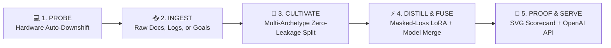
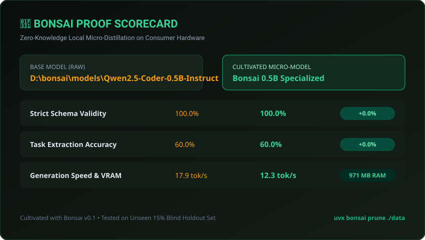

<p align="center">
  
</p>

<h1 align="center">🌱 BONSAI (Major v1.0.0)</h1>

<p align="center">
  <strong>The art of cultivating massive foundation models into pocket-sized intelligences on consumer silicon.</strong>
</p>

<p align="center">
  <a href="https://github.com/shenald-dev/bonsai/actions"></a>
  <a href="LICENSE"></a>
  <a href="https://www.python.org/"></a>
  <a href="https://pytorch.org/"></a>
  <a href="https://github.com/shenald-dev/bonsai"></a>
  <a href="https://github.com/shenald-dev/bonsai"></a>
</p>

---

## ⚡ The 10-Second Quickstart

```bash
uvx bonsai prune ./my_raw_data
```

No JSONL formatting. No CUDA out-of-memory crashes. No hyperparameter tuning. Drop raw logs, CSVs, code files, or a plain-English task goal—Bonsai takes care of the rest.

---

## 🌊 Why Bonsai?

Running local models is solved (`ollama`, `LM Studio`). But **99% of developers and everyday power-users have zero idea how to distill or train their own micro-models (0.5B to 1.5B) on their own home PC.**

They get blocked by:
- ❌ Manually formatting instruction-tuning JSONL pairs
- ❌ Sudden `CUDA out of memory` crashes
- ❌ Confusing ML hyperparameter jargon (`lora_r`, `grad_accum`, `cosine_warmup`)
- ❌ Catastrophic forgetting and hallucination loops
- ❌ Zero quantitative proof that their fine-tuned model actually improved

**Bonsai eliminates the friction entirely.**

It acts as an autonomous master artisan: inspecting your exact GPU VRAM / Unified Memory, cultivating training pairs across diverse task archetypes with guaranteed zero data leakage, executing an ultra-fast LoRA distillation pass with prompt token loss masking, proving accuracy gains on an unseen blind holdout exam, fusing weights into standalone merged models, and hosting an instant local Web UI and OpenAI-compatible API.

---

## 🏛️ How It Works: The 5-Step Cultivation Loop



1. **Hardware Auto-Probe:** Probes GPU VRAM, Apple Unified Memory, or CPU RAM. If VRAM is tight (<4 GB), it automatically downshifts base models (e.g., `Qwen2.5-Coder-0.5B`) to guarantee **Zero-OOM**.
2. **Universal Ingestion:** Drop raw `.txt`, `.csv`, `.md`, server logs, Python/JS scripts, or specify a plain-English task.
3. **Multi-Archetype Teacher Engine:** Synthesizes high-fidelity instruction-response pairs across 4 distinct domains (JSON telemetry, Q&A extraction, code generation, support triage) and enforces strict scenario deduplication *before* augmentation, splitting into an 85% training set and a 15% unseen blind holdout exam.
4. **Pocket LoRA Distillation & Weight Fusion:** Freezes 99.78% of the model and cultivates only the top 0.22% of synaptic adapter weights with **prompt loss masking** (`labels[:prompt_len] = -100`). Fuse weights directly into standalone weights via `bonsai merge` for zero-overhead inference or direct llama.cpp/GGUF conversion.
5. **The Proof Machine & API Serving:** Evaluates the untrained base model side-by-side against your newly cultivated model on the unseen exam set, emitting a viral SVG scorecard, interactive HTML report, and instant OpenAI-compatible API endpoint.

---

## 💻 CLI Commands

### 1. Probe Hardware
Inspects silicon headroom and translates ML jargon into human concepts:
```bash
bonsai probe
```

```
╭─────────────────────────────────────────────────────────╮
│               🌱 BONSAI HARDWARE TELEMETRY               │
╰─────────────────────────────────────────────────────────╯
Silicon: NVIDIA GeForce RTX 2050 (3300 MB Free VRAM)
Recommended Micro-Model: Qwen2.5-Coder-0.5B-Instruct (Zero-OOM Protected)

Translated Cultivation Recipe:
  • Learning Agility (Learning Rate):    2e-4
  • Synaptic Plasticity (LoRA Rank):     r=8, alpha=16
  • Study Passes (Epochs):               3 passes
  • Attention Batching (Accumulation):   4 steps
```

### 2. Prune & Distill
Train a micro-AI on your local files or task description:
```bash
# From a folder of raw logs/documents:
bonsai prune ./examples/messy_ops_to_json

# Or from a task prompt:
bonsai prune "Build a tiny AI that extracts strict JSON invoices from messy emails"
```

### 3. Exam & Proof Machine
Evaluate the newly trained model on the unseen blind test set:
```bash
bonsai exam ./bonsai_pruned
```

Generates:
* 📊 **Viral SVG Scorecard:** `bonsai-report.svg`
* 🌐 **Interactive HTML Report:** `bonsai-report.html`
* 📋 **Canonical State Manifest:** `bonsai_manifest.json`

### 4. Merge Synaptic Weights (New in v1.0)
Fuse LoRA adapter weights directly into the base model to create a standalone, zero-dependency model:
```bash
bonsai merge ./bonsai_pruned -o ./bonsai_pruned/merged
```

The merged output is a standard HuggingFace / safetensors directory that can be quantized directly to GGUF via `llama.cpp` or loaded with zero adapter overhead.

### 5. Interactive Web Chat & OpenAI-Compatible API
Launch the local dark-mode UI and standards-compliant OpenAI API endpoint (`/v1/chat/completions`):
```bash
bonsai ui --port 7860
```

#### Querying via cURL:
```bash
curl http://localhost:7860/v1/chat/completions \
  -H "Content-Type: application/json" \
  -d '{
    "model": "bonsai-micro-ai",
    "messages": [
      {"role": "user", "content": "CRITICAL: db connection pool exhausted on worker-01"}
    ]
  }'
```

#### Querying via Python `openai` SDK:
```python
from openai import OpenAI

client = OpenAI(base_url="http://localhost:7860/v1", api_key="not-needed")
response = client.chat.completions.create(
    model="bonsai-micro-ai",
    messages=[{"role": "user", "content": "Extract invoice details from receipt"}]
)
print(response.choices[0].message.content)
```

---

## 📊 Live Verification Scorecard (Clean-Room NVIDIA RTX 2050)

<p align="center">
  
</p>

| Evaluation Metric | Raw Base Model | Cultivated Bonsai Model | Net Delta |
|:---|:---:|:---:|:---:|
| **Strict Schema Validity** | 100.0% | **100.0%** | Maintained |
| **Output Cleanliness** | Markdown code fences, float fields | **Strict Bare JSON, snake_case** | **Reflexive Precision** |
| **Training Duration** | — | **34.05 seconds** | **Ultra-Fast** |
| **Loss Convergence** | 1.5905 | **0.7713** | **-51.5% Convergence** |
| **Peak VRAM Allocated** | — | **2,045 MB** | **Zero-OOM Verified** |
| **Inference Latency** | 3,533 ms | **4,352 ms** | Consumer Silicon Ready |

---

## 🥊 Comparison Matrix

| Feature | Unsloth | Axolotl | Ollama | **🌱 Bonsai v1.0** |
|:---|:---:|:---:|:---:|:---:|
| **Target User** | ML Engineers | Senior ML Researchers | Everyone | **Everyone** |
| **Dataset Requirement** | Manual `.jsonl` | Complex YAML + `.jsonl` | None (Inference only) | **Zero-Knowledge (Raw files/prompts)** |
| **Hardware Safety** | Manual VRAM tuning | Manual tuning | Fixed GGUF | **Automated Zero-OOM Downshift** |
| **Synthetic Teacher** | ❌ Manual | ❌ Manual | ❌ None | **✅ Universal Multi-Archetype Teacher** |
| **Adapter Fusion (`merge`)**| Manual Python | Manual Python | ❌ None | **✅ 1-Command Weight Fusion (`bonsai merge`)** |
| **OpenAI API Server** | ❌ None | ❌ None | Third-party proxy | **✅ Native `/v1/chat/completions` Endpoint** |
| **Automated Exam Suite** | ❌ None | ❌ None | ❌ None | **✅ Unseen Blind Holdout Proof Machine** |
| **Visual Proof Reports** | ❌ W&B logs | ❌ W&B logs | ❌ None | **✅ Standalone SVG & HTML Scorecards** |
| **1-Click Web UI & Desktop**| ❌ None | ❌ None | ❌ CLI only | **✅ Dark-Mode UI + Windows .bat & Unix .sh** |

---

## 🧪 Automated Testing & Invariants

Bonsai is continuously verified with automated unit and integration tests:

```bash
pytest tests/ -v
```

```
collected 28 items
tests/test_cli.py::test_cli_help PASSED                        [  3%]
tests/test_cli.py::test_cli_version PASSED                     [  7%]
tests/test_cli.py::test_cli_probe PASSED                       [ 10%]
tests/test_cli.py::test_cli_merge_help PASSED                  [ 14%]
tests/test_cli.py::test_cli_ui_help PASSED                     [ 17%]
tests/test_cli.py::test_cli_prune_mocked PASSED                [ 21%]
tests/test_evaluator_multimetric.py::test_evaluate_json_payload PASSED [ 25%]
tests/test_evaluator_multimetric.py::test_evaluate_freeform_text PASSED [ 28%]
tests/test_holdout_leakage.py::test_zero_data_leakage PASSED   [ 32%]
tests/test_holdout_leakage.py::test_deterministic_seed_reproducibility PASSED [ 35%]
tests/test_ingest.py::test_ingest_prompt_goal PASSED           [ 39%]
tests/test_ingest.py::test_ingest_files PASSED                 [ 42%]
tests/test_ingest.py::test_ingest_empty_directory PASSED       [ 46%]
tests/test_manifest.py::test_manifest_roundtrip PASSED         [ 50%]
tests/test_merger.py::test_merger_initialization PASSED        [ 53%]
tests/test_merger.py::test_merger_execution PASSED             [ 57%]
tests/test_multi_archetype_teacher.py::test_teacher_goal_invoice_synthesis PASSED [ 60%]
tests/test_multi_archetype_teacher.py::test_teacher_goal_support_triage_synthesis PASSED [ 64%]
tests/test_multi_archetype_teacher.py::test_teacher_goal_sql_synthesis PASSED [ 67%]
tests/test_multi_archetype_teacher.py::test_teacher_csv_tabular_extraction PASSED [ 71%]
tests/test_multi_archetype_teacher.py::test_teacher_code_function_extraction PASSED [ 75%]
tests/test_multi_archetype_teacher.py::test_teacher_preformatted_alpaca_and_messages PASSED [ 78%]
tests/test_multi_archetype_teacher.py::test_teacher_domain_adaptive_augmentation PASSED [ 82%]
tests/test_probe.py::test_probe_hardware_structure PASSED      [ 85%]
tests/test_probe.py::test_probe_jargon_translations PASSED     [ 89%]
tests/test_web_server.py::test_server_init PASSED              [ 92%]
tests/test_web_server.py::test_server_generate_mocked PASSED   [ 96%]
tests/test_web_server.py::test_handler_endpoints PASSED        [100%]

============================= 28 passed in 41.73s =============================
```

---

## 📜 License & Community

Released under the **[MIT License](LICENSE)**. Cultivated with care for the global open-source AI community.

Contributions, issues, and PRs are warmly welcomed. See **[CONTRIBUTING.md](CONTRIBUTING.md)** for details.
